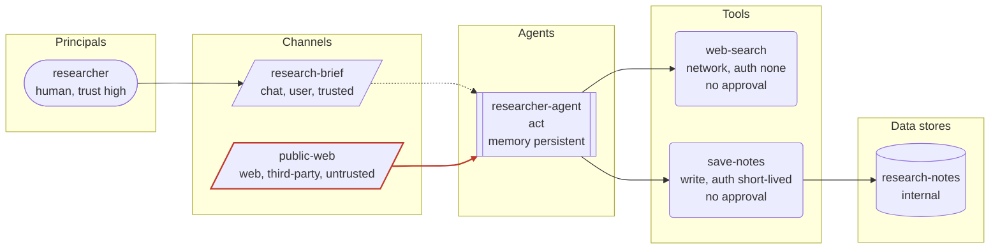

# Threat model: Web research agent

Generated by agent-threat-model 0.4.0 from `examples/research-agent.yaml`. Deterministic output: the same input always produces this report.

Investigates user questions by searching and reading public web pages, saves structured notes and carries useful context into later sessions.

Owner: research-platform team

## Executive summary

16 of the catalogue threats apply to 'Web research agent' (0 critical, 5 high, 11 medium, 0 low after mitigations). Residual risk score 88/100 (Critical). The 1 control(s) in place reduce modelled risk by 12% compared with the same system with no controls.

| Severity | Inherent | Residual |
|---|---|---|
| Critical | 0 | 0 |
| High | 9 | 5 |
| Medium | 7 | 11 |
| Low | 0 | 0 |

Top threats after mitigations:

1. **Indirect prompt injection via untrusted channel** (`indirect-prompt-injection`), residual 16 High: agent 'researcher-agent' reads untrusted channel 'public-web' (web, origin third-party)
1. **Excessive agency on write, exec or payment tools** (`excessive-agency`), residual 14.1 High: agent 'researcher-agent' (act) can call tool 'save-notes' (write) with approval: none
1. **Denial of wallet** (`denial-of-wallet`), residual 12 High: control 'budget-caps' is not in place

Highest-leverage missing controls:

- `approval-gates` Human approval for high-impact actions: mitigates 6 applicable threat(s)
- `least-privilege-tool-scopes` Least-privilege scopes on every tool: mitigates 5 applicable threat(s)
- `adversarial-testing` Adversarial testing before and after release: mitigates 4 applicable threat(s)
- `runtime-policy-enforcement` Enforce policy outside the model: mitigates 4 applicable threat(s)
- `argument-validation` Strict schemas for tool arguments: mitigates 3 applicable threat(s)

## System diagram

Dashed edges are trusted channels; solid red edges are untrusted channels (attacker-influenced content reaches the agent).

## System overview

| Element | Id | Details |
|---|---|---|
| Principal | `researcher` | human, trust high |
| Agent | `researcher-agent` | autonomy act, memory persistent, inputs 2, tools 2 |
| Channel | `research-brief` | chat, origin user, trusted |
| Channel | `public-web` | web, origin third-party, untrusted |
| Tool | `web-search` | network, auth none, approval none, sandboxed |
| Tool | `save-notes` | write, auth short-lived, approval none, sandboxed |
| Data store | `research-notes` | internal |

## Threat register

| # | Threat | STRIDE | OWASP LLM | Inherent | Residual | Affected |
|---|---|---|---|---|---|---|
| 1 | [Indirect prompt injection via untrusted channel](#1-indirect-prompt-injection-via-untrusted-channel-indirect-prompt-injection) | Tampering | LLM01 | 16 High | 16 High | `public-web`, `researcher-agent` |
| 2 | [Excessive agency on write, exec or payment tools](#2-excessive-agency-on-write-exec-or-payment-tools-excessive-agency) | Elevation of privilege | LLM06 | 16 High | 14.1 High | `researcher-agent`, `save-notes` |
| 3 | [Denial of wallet](#3-denial-of-wallet-denial-of-wallet) | Denial of service | LLM10 | 12 High | 12 High | `researcher-agent`, `web-search` |
| 4 | [Direct prompt injection and jailbreak by a user](#4-direct-prompt-injection-and-jailbreak-by-a-user-direct-prompt-injection) | Tampering | LLM01 | 12 High | 12 High | `research-brief`, `researcher-agent` |
| 5 | [No kill switch or credential revocation](#5-no-kill-switch-or-credential-revocation-missing-kill-switch) | Elevation of privilege | LLM06 | 12 High | 12 High | `researcher-agent` |
| 6 | [Persistent memory poisoning](#6-persistent-memory-poisoning-memory-poisoning) | Tampering | LLM01, LLM04 | 12 High | 10.4 Medium | `researcher-agent` |
| 7 | [Server-side request forgery through URL-accepting tools](#7-server-side-request-forgery-through-url-accepting-tools-ssrf-via-url-tool) | Information disclosure | LLM06, LLM05 | 12 High | 10.4 Medium | `researcher-agent`, `web-search` |
| 8 | [Destructive actions through write tools](#8-destructive-actions-through-write-tools-destructive-write-actions) | Tampering | LLM06, LLM01 | 12 High | 10.1 Medium | `public-web`, `researcher-agent`, `save-notes` |
| 9 | [Side-effecting tool with no authentication](#9-side-effecting-tool-with-no-authentication-unauthenticated-tool) | Spoofing | LLM06 | 12 High | 9.8 Medium | `researcher-agent`, `web-search` |
| 10 | [Acting on hallucinated facts or identifiers](#10-acting-on-hallucinated-facts-or-identifiers-hallucinated-actions) | Tampering | LLM09, LLM06 | 9 Medium | 9 Medium | `researcher-agent`, `save-notes` |
| 11 | [Model output consumed without validation](#11-model-output-consumed-without-validation-insecure-output-handling) | Tampering | LLM05 | 9 Medium | 9 Medium | `public-web`, `researcher-agent`, `save-notes` |
| 12 | [No rate limits on tool calls](#12-no-rate-limits-on-tool-calls-no-rate-limits) | Denial of service | LLM10 | 9 Medium | 9 Medium | `researcher-agent` |
| 13 | [Memory leaks between users or sessions](#13-memory-leaks-between-users-or-sessions-session-cross-contamination) | Information disclosure | LLM02 | 8 Medium | 8 Medium | `research-brief`, `researcher-agent` |
| 14 | [Unpinned model or tool versions](#14-unpinned-model-or-tool-versions-supply-chain-unpinned) | Tampering | LLM03 | 8 Medium | 8 Medium | `researcher-agent`, `save-notes`, `web-search` |
| 15 | [System prompt and configuration leakage](#15-system-prompt-and-configuration-leakage-system-prompt-leakage) | Information disclosure | LLM07 | 8 Medium | 8 Medium | `public-web`, `research-brief`, `researcher-agent` |
| 16 | [Agent configuration tampering](#16-agent-configuration-tampering-agent-config-tampering) | Tampering | LLM03, LLM06 | 8 Medium | 6.9 Medium | `researcher-agent`, `save-notes` |

### 1. Indirect prompt injection via untrusted channel (`indirect-prompt-injection`)

Content the agent reads from an untrusted channel (email, web pages, documents, retrieved passages, API responses) carries instructions that the model follows as if they came from the operator. Every tool the agent can reach becomes available to whoever wrote that content.

| Field | Value |
|---|---|
| STRIDE | Tampering |
| OWASP LLM Top 10 (2025) | LLM01 Prompt Injection |
| OWASP Agentic Top 10 (2026) | ASI01 Agent Goal Hijack |
| MITRE ATLAS | [AML.T0051.001](https://atlas.mitre.org/techniques/AML.T0051.001) |
| Inherent severity | 16 (High): likelihood 4 x impact 4 |
| Residual severity | 16 (High), mitigation coverage 0% |
| Affected elements | `public-web`, `researcher-agent` |
| Rule | `untrusted_channel_in_agent_inputs` |

Why it applies:

- agent 'researcher-agent' reads untrusted channel 'public-web' (web, origin third-party)

Mitigations:

- [ ] `input-provenance-tagging` Tag every input with its provenance and trust level
- [ ] `untrusted-content-isolation` Isolate untrusted content from the privileged agent
- [ ] `prompt-injection-filtering` Detect injection attempts in untrusted content
- [ ] `least-privilege-tool-scopes` Least-privilege scopes on every tool
- [ ] `approval-gates` Human approval for high-impact actions

References:

- <https://github.com/OWASP/www-project-top-10-for-large-language-model-applications/blob/main/2_0_vulns/LLM01_PromptInjection.md>

### 2. Excessive agency on write, exec or payment tools (`excessive-agency`)

An agent that may act on its own can call a tool with side effects without any approval step. One wrong inference, one injected instruction or one hallucinated argument becomes a real-world action.

| Field | Value |
|---|---|
| STRIDE | Elevation of privilege |
| OWASP LLM Top 10 (2025) | LLM06 Excessive Agency |
| OWASP Agentic Top 10 (2026) | ASI02 Tool Misuse and Exploitation, ASI03 Identity and Privilege Abuse |
| MITRE ATLAS | [AML.T0053](https://atlas.mitre.org/techniques/AML.T0053) |
| Inherent severity | 16 (High): likelihood 4 x impact 4 |
| Residual severity | 14.1 (High), mitigation coverage 15% |
| Affected elements | `researcher-agent`, `save-notes` |
| Rule | `tool_kind_without_approval(kinds=write|exec|payment)` |

Why it applies:

- agent 'researcher-agent' (act) can call tool 'save-notes' (write) with approval: none

Mitigations:

- [x] `audit-log` Tamper-evident audit log of every tool call
- [ ] `approval-gates` Human approval for high-impact actions
- [ ] `runtime-policy-enforcement` Enforce policy outside the model
- [ ] `least-privilege-tool-scopes` Least-privilege scopes on every tool
- [ ] `kill-switch` Kill switch with credential revocation

References:

- <https://github.com/OWASP/www-project-top-10-for-large-language-model-applications/blob/main/2_0_vulns/LLM06_ExcessiveAgency.md>

### 3. Denial of wallet (`denial-of-wallet`)

The agent can spend money or paid API quota and nothing caps the amount per task. A loop, an injection or a malicious user turns the agent into a bill.

| Field | Value |
|---|---|
| STRIDE | Denial of service |
| OWASP LLM Top 10 (2025) | LLM10 Unbounded Consumption |
| OWASP Agentic Top 10 (2026) | ASI08 Cascading Failures |
| MITRE ATLAS | [AML.T0034.002](https://atlas.mitre.org/techniques/AML.T0034.002), [AML.T0034](https://atlas.mitre.org/techniques/AML.T0034) |
| Inherent severity | 12 (High): likelihood 3 x impact 4 |
| Residual severity | 12 (High), mitigation coverage 0% |
| Affected elements | `researcher-agent`, `web-search` |
| Rule | `all(control_missing(control=budget-caps), any(agent_has_tool_kind(kinds=payment|network), agent_autonomy_in(autonomy=act)))` |

Why it applies:

- control 'budget-caps' is not in place
- agent 'researcher-agent' can call tool 'web-search' (network)
- agent 'researcher-agent' has autonomy act

Mitigations:

- [ ] `budget-caps` Hard budget caps on spend and tokens
- [ ] `rate-limiting` Rate limits on tool calls and iterations
- [ ] `approval-gates` Human approval for high-impact actions
- [ ] `behavioural-monitoring` Monitor agent behaviour for anomalies

References:

- <https://github.com/OWASP/www-project-top-10-for-large-language-model-applications/blob/main/2_0_vulns/LLM10_UnboundedConsumption.md>

### 4. Direct prompt injection and jailbreak by a user (`direct-prompt-injection`)

A user types instructions that override the system prompt or safety guidance, then uses the agent's tools for purposes the operator did not intend. Any agent that accepts user input and has tools is exposed.

| Field | Value |
|---|---|
| STRIDE | Tampering |
| OWASP LLM Top 10 (2025) | LLM01 Prompt Injection |
| OWASP Agentic Top 10 (2026) | ASI01 Agent Goal Hijack |
| MITRE ATLAS | [AML.T0051.000](https://atlas.mitre.org/techniques/AML.T0051.000), [AML.T0054](https://atlas.mitre.org/techniques/AML.T0054) |
| Inherent severity | 12 (High): likelihood 4 x impact 3 |
| Residual severity | 12 (High), mitigation coverage 0% |
| Affected elements | `research-brief`, `researcher-agent` |
| Rule | `all(agent_has_input_of_origin(origin=user), agent_has_any_tool)` |

Why it applies:

- agent 'researcher-agent' reads channel 'research-brief' with origin user
- agent 'researcher-agent' can call 2 tool(s)

Mitigations:

- [ ] `least-privilege-tool-scopes` Least-privilege scopes on every tool
- [ ] `runtime-policy-enforcement` Enforce policy outside the model
- [ ] `approval-gates` Human approval for high-impact actions
- [ ] `prompt-injection-filtering` Detect injection attempts in untrusted content
- [ ] `adversarial-testing` Adversarial testing before and after release

### 5. No kill switch or credential revocation (`missing-kill-switch`)

An agent that acts in the world cannot be stopped quickly. When behaviour goes wrong the only options are to find the process and the keys by hand while actions keep happening.

| Field | Value |
|---|---|
| STRIDE | Elevation of privilege |
| OWASP LLM Top 10 (2025) | LLM06 Excessive Agency |
| OWASP Agentic Top 10 (2026) | ASI10 Rogue Agents, ASI08 Cascading Failures |
| MITRE ATLAS | - |
| Inherent severity | 12 (High): likelihood 3 x impact 4 |
| Residual severity | 12 (High), mitigation coverage 0% |
| Affected elements | `researcher-agent` |
| Rule | `all(control_missing(control=kill-switch), agent_autonomy_in(autonomy=act|act-with-approval))` |

Why it applies:

- control 'kill-switch' is not in place
- agent 'researcher-agent' has autonomy act

Mitigations:

- [ ] `kill-switch` Kill switch with credential revocation
- [ ] `brokered-credentials` Short-lived, scoped, brokered credentials
- [ ] `incident-response-playbook` Incident response playbook for agent incidents

### 6. Persistent memory poisoning (`memory-poisoning`)

The agent writes what it learns into long-term memory. Content from one interaction (possibly injected) is stored and later retrieved as trusted context, so a single poisoned message steers every future session.

| Field | Value |
|---|---|
| STRIDE | Tampering |
| OWASP LLM Top 10 (2025) | LLM01 Prompt Injection, LLM04 Data and Model Poisoning |
| OWASP Agentic Top 10 (2026) | ASI06 Memory & Context Poisoning |
| MITRE ATLAS | [AML.T0080.000](https://atlas.mitre.org/techniques/AML.T0080.000) |
| Inherent severity | 12 (High): likelihood 3 x impact 4 |
| Residual severity | 10.4 (Medium), mitigation coverage 17% |
| Affected elements | `researcher-agent` |
| Rule | `agent_memory_is(memory=persistent)` |

Why it applies:

- agent 'researcher-agent' keeps persistent memory

Mitigations:

- [x] `audit-log` Tamper-evident audit log of every tool call
- [ ] `memory-write-validation` Validate and expire writes to persistent memory
- [ ] `session-isolation` Isolate memory and context per user and session
- [ ] `input-provenance-tagging` Tag every input with its provenance and trust level

### 7. Server-side request forgery through URL-accepting tools (`ssrf-via-url-tool`)

A tool fetches URLs chosen by the model. Attacker-influenced input makes it request internal services, cloud metadata endpoints or private address ranges, and the response flows back into the context.

| Field | Value |
|---|---|
| STRIDE | Information disclosure |
| OWASP LLM Top 10 (2025) | LLM06 Excessive Agency, LLM05 Improper Output Handling |
| OWASP Agentic Top 10 (2026) | ASI02 Tool Misuse and Exploitation |
| MITRE ATLAS | [AML.T0053](https://atlas.mitre.org/techniques/AML.T0053) |
| Inherent severity | 12 (High): likelihood 3 x impact 4 |
| Residual severity | 10.4 (Medium), mitigation coverage 17% |
| Affected elements | `researcher-agent`, `web-search` |
| Rule | `agent_has_tool_kind(kinds=network)` |

Why it applies:

- agent 'researcher-agent' can call tool 'web-search' (network)

Mitigations:

- [x] `audit-log` Tamper-evident audit log of every tool call
- [ ] `egress-allowlist` Allowlist network egress and message recipients
- [ ] `argument-validation` Strict schemas for tool arguments
- [ ] `sandboxed-execution` Run code and shell tools in an ephemeral sandbox

References:

- <https://cheatsheetseries.owasp.org/cheatsheets/Server_Side_Request_Forgery_Prevention_Cheat_Sheet.html>

### 8. Destructive actions through write tools (`destructive-write-actions`)

The agent can modify or delete data and reads untrusted content. An injected instruction (or a plain mistake) deletes records, overwrites files or force-pushes over history.

| Field | Value |
|---|---|
| STRIDE | Tampering |
| OWASP LLM Top 10 (2025) | LLM06 Excessive Agency, LLM01 Prompt Injection |
| OWASP Agentic Top 10 (2026) | ASI02 Tool Misuse and Exploitation |
| MITRE ATLAS | [AML.T0101](https://atlas.mitre.org/techniques/AML.T0101) |
| Inherent severity | 12 (High): likelihood 3 x impact 4 |
| Residual severity | 10.1 (Medium), mitigation coverage 19% |
| Affected elements | `public-web`, `researcher-agent`, `save-notes` |
| Rule | `all(agent_has_tool_kind(kinds=write), untrusted_channel_in_agent_inputs)` |

Why it applies:

- agent 'researcher-agent' can call tool 'save-notes' (write)
- agent 'researcher-agent' reads untrusted channel 'public-web' (web, origin third-party)

Mitigations:

- [x] `audit-log` Tamper-evident audit log of every tool call
- [ ] `approval-gates` Human approval for high-impact actions
- [ ] `backups-and-rollback` Backups and rollback for agent-writable data
- [ ] `least-privilege-tool-scopes` Least-privilege scopes on every tool

### 9. Side-effecting tool with no authentication (`unauthenticated-tool`)

A tool that writes, executes, pays, sends or fetches requires no authentication at all. Calls cannot be attributed to an agent or principal, and anything that can reach the endpoint can use it.

| Field | Value |
|---|---|
| STRIDE | Spoofing |
| OWASP LLM Top 10 (2025) | LLM06 Excessive Agency |
| OWASP Agentic Top 10 (2026) | ASI03 Identity and Privilege Abuse |
| MITRE ATLAS | [AML.T0053](https://atlas.mitre.org/techniques/AML.T0053) |
| Inherent severity | 12 (High): likelihood 3 x impact 4 |
| Residual severity | 9.8 (Medium), mitigation coverage 23% |
| Affected elements | `researcher-agent`, `web-search` |
| Rule | `tool_auth_in(auth=none, kinds=write|exec|payment|messaging|network)` |

Why it applies:

- tool 'web-search' (network) uses auth: none

Mitigations:

- [x] `audit-log` Tamper-evident audit log of every tool call
- [ ] `agent-identity` Authenticated identities for agents and principals
- [ ] `brokered-credentials` Short-lived, scoped, brokered credentials

### 10. Acting on hallucinated facts or identifiers (`hallucinated-actions`)

The agent invents a package name, account id, file path or amount and a side-effecting tool executes it. Attackers register the names models tend to invent so the mistake resolves to something malicious.

| Field | Value |
|---|---|
| STRIDE | Tampering |
| OWASP LLM Top 10 (2025) | LLM09 Misinformation, LLM06 Excessive Agency |
| OWASP Agentic Top 10 (2026) | ASI02 Tool Misuse and Exploitation, ASI04 Agentic Supply Chain Vulnerabilities |
| MITRE ATLAS | [AML.T0060](https://atlas.mitre.org/techniques/AML.T0060), [AML.T0053](https://atlas.mitre.org/techniques/AML.T0053) |
| Inherent severity | 9 (Medium): likelihood 3 x impact 3 |
| Residual severity | 9 (Medium), mitigation coverage 0% |
| Affected elements | `researcher-agent`, `save-notes` |
| Rule | `all(agent_autonomy_in(autonomy=act|act-with-approval), agent_has_tool_kind(kinds=exec|write|payment))` |

Why it applies:

- agent 'researcher-agent' has autonomy act
- agent 'researcher-agent' can call tool 'save-notes' (write)

Mitigations:

- [ ] `argument-validation` Strict schemas for tool arguments
- [ ] `approval-gates` Human approval for high-impact actions
- [ ] `tool-integrity-pinning` Pin tool versions and hash tool descriptions
- [ ] `adversarial-testing` Adversarial testing before and after release

References:

- <https://arxiv.org/abs/2406.10279>

### 11. Model output consumed without validation (`insecure-output-handling`)

Downstream components render model output in a browser, pass it to a shell or database, or execute it. Injected or malformed output becomes cross-site scripting, command injection or unintended writes.

| Field | Value |
|---|---|
| STRIDE | Tampering |
| OWASP LLM Top 10 (2025) | LLM05 Improper Output Handling |
| OWASP Agentic Top 10 (2026) | ASI05 Unexpected Code Execution (RCE) |
| MITRE ATLAS | [AML.T0077](https://atlas.mitre.org/techniques/AML.T0077), [AML.T0067](https://atlas.mitre.org/techniques/AML.T0067) |
| Inherent severity | 9 (Medium): likelihood 3 x impact 3 |
| Residual severity | 9 (Medium), mitigation coverage 0% |
| Affected elements | `public-web`, `researcher-agent`, `save-notes` |
| Rule | `any(agent_has_tool_kind(kinds=exec|write), agent_has_channel_kind(kinds=web))` |

Why it applies:

- agent 'researcher-agent' can call tool 'save-notes' (write)
- agent 'researcher-agent' reads untrusted web channel 'public-web'

Mitigations:

- [ ] `output-encoding` Treat model output as untrusted data downstream
- [ ] `argument-validation` Strict schemas for tool arguments
- [ ] `sandboxed-execution` Run code and shell tools in an ephemeral sandbox

References:

- <https://github.com/OWASP/www-project-top-10-for-large-language-model-applications/blob/main/2_0_vulns/LLM05_ImproperOutputHandling.md>

### 12. No rate limits on tool calls (`no-rate-limits`)

Nothing bounds how many tool calls or loop iterations an agent may make. A runaway loop or an attacker-driven burst exhausts quotas, floods downstream systems and amplifies every other threat.

| Field | Value |
|---|---|
| STRIDE | Denial of service |
| OWASP LLM Top 10 (2025) | LLM10 Unbounded Consumption |
| OWASP Agentic Top 10 (2026) | ASI08 Cascading Failures |
| MITRE ATLAS | [AML.T0029](https://atlas.mitre.org/techniques/AML.T0029), [AML.T0034](https://atlas.mitre.org/techniques/AML.T0034) |
| Inherent severity | 9 (Medium): likelihood 3 x impact 3 |
| Residual severity | 9 (Medium), mitigation coverage 0% |
| Affected elements | `researcher-agent` |
| Rule | `all(control_missing(control=rate-limiting), agent_has_any_tool)` |

Why it applies:

- control 'rate-limiting' is not in place
- agent 'researcher-agent' can call 2 tool(s)

Mitigations:

- [ ] `rate-limiting` Rate limits on tool calls and iterations
- [ ] `budget-caps` Hard budget caps on spend and tokens
- [ ] `behavioural-monitoring` Monitor agent behaviour for anomalies

### 13. Memory leaks between users or sessions (`session-cross-contamination`)

The agent keeps memory and serves more than one user. Without strict partitioning, one user's data or instructions surface in another user's session.

| Field | Value |
|---|---|
| STRIDE | Information disclosure |
| OWASP LLM Top 10 (2025) | LLM02 Sensitive Information Disclosure |
| OWASP Agentic Top 10 (2026) | ASI06 Memory & Context Poisoning |
| MITRE ATLAS | [AML.T0057](https://atlas.mitre.org/techniques/AML.T0057), [AML.T0092](https://atlas.mitre.org/techniques/AML.T0092) |
| Inherent severity | 8 (Medium): likelihood 2 x impact 4 |
| Residual severity | 8 (Medium), mitigation coverage 0% |
| Affected elements | `research-brief`, `researcher-agent` |
| Rule | `all(agent_memory_is(memory=session|persistent), agent_has_input_of_origin(origin=user))` |

Why it applies:

- agent 'researcher-agent' keeps persistent memory
- agent 'researcher-agent' reads channel 'research-brief' with origin user

Mitigations:

- [ ] `session-isolation` Isolate memory and context per user and session
- [ ] `per-user-authorisation` Access data with the end user's permissions
- [ ] `memory-write-validation` Validate and expire writes to persistent memory

### 14. Unpinned model or tool versions (`supply-chain-unpinned`)

The model version, tool packages or tool servers are not pinned. A silent upstream change (or a deliberate rug pull) alters behaviour and permissions without any review.

| Field | Value |
|---|---|
| STRIDE | Tampering |
| OWASP LLM Top 10 (2025) | LLM03 Supply Chain |
| OWASP Agentic Top 10 (2026) | ASI04 Agentic Supply Chain Vulnerabilities |
| MITRE ATLAS | [AML.T0010](https://atlas.mitre.org/techniques/AML.T0010), [AML.T0010.005](https://atlas.mitre.org/techniques/AML.T0010.005), [AML.T0109](https://atlas.mitre.org/techniques/AML.T0109) |
| Inherent severity | 8 (Medium): likelihood 2 x impact 4 |
| Residual severity | 8 (Medium), mitigation coverage 0% |
| Affected elements | `researcher-agent`, `save-notes`, `web-search` |
| Rule | `any(agent_model_unpinned, tool_unpinned)` |

Why it applies:

- agent 'researcher-agent' does not declare a pinned model version
- tool 'web-search' (network) version or description is not pinned
- tool 'save-notes' (write) version or description is not pinned

Mitigations:

- [ ] `tool-integrity-pinning` Pin tool versions and hash tool descriptions
- [ ] `model-version-pinning` Pin and change-control the model version
- [ ] `adversarial-testing` Adversarial testing before and after release

References:

- <https://github.com/OWASP/www-project-top-10-for-large-language-model-applications/blob/main/2_0_vulns/LLM03_SupplyChain.md>

### 15. System prompt and configuration leakage (`system-prompt-leakage`)

Users or third-party content can coax the model into revealing its system prompt, tool list and configuration. On its own this is reconnaissance; it becomes serious when the prompt holds secrets or business rules.

| Field | Value |
|---|---|
| STRIDE | Information disclosure |
| OWASP LLM Top 10 (2025) | LLM07 System Prompt Leakage |
| OWASP Agentic Top 10 (2026) | not mapped |
| MITRE ATLAS | [AML.T0056](https://atlas.mitre.org/techniques/AML.T0056), [AML.T0069.002](https://atlas.mitre.org/techniques/AML.T0069.002), [AML.T0084](https://atlas.mitre.org/techniques/AML.T0084), [AML.T0084.001](https://atlas.mitre.org/techniques/AML.T0084.001) |
| Inherent severity | 8 (Medium): likelihood 4 x impact 2 |
| Residual severity | 8 (Medium), mitigation coverage 0% |
| Affected elements | `public-web`, `research-brief`, `researcher-agent` |
| Rule | `agent_has_input_of_origin(origin=user|third-party)` |

Why it applies:

- agent 'researcher-agent' reads channel 'research-brief' with origin user
- agent 'researcher-agent' reads channel 'public-web' with origin third-party

Mitigations:

- [ ] `secrets-out-of-context` Keep secrets out of the model context
- [ ] `runtime-policy-enforcement` Enforce policy outside the model
- [ ] `adversarial-testing` Adversarial testing before and after release

References:

- <https://github.com/OWASP/www-project-top-10-for-large-language-model-applications/blob/main/2_0_vulns/LLM07_SystemPromptLeakage.md>

### 16. Agent configuration tampering (`agent-config-tampering`)

Prompts, tool lists and policies live in files or stores an agent can write to, or that lack change control. Modifying them silently changes what the agent is allowed to do.

| Field | Value |
|---|---|
| STRIDE | Tampering |
| OWASP LLM Top 10 (2025) | LLM03 Supply Chain, LLM06 Excessive Agency |
| OWASP Agentic Top 10 (2026) | ASI10 Rogue Agents, ASI04 Agentic Supply Chain Vulnerabilities |
| MITRE ATLAS | [AML.T0081](https://atlas.mitre.org/techniques/AML.T0081) |
| Inherent severity | 8 (Medium): likelihood 2 x impact 4 |
| Residual severity | 6.9 (Medium), mitigation coverage 17% |
| Affected elements | `researcher-agent`, `save-notes` |
| Rule | `all(agent_has_tool_kind(kinds=write|exec), control_missing(control=runtime-policy-enforcement))` |

Why it applies:

- agent 'researcher-agent' can call tool 'save-notes' (write)
- control 'runtime-policy-enforcement' is not in place

Mitigations:

- [x] `audit-log` Tamper-evident audit log of every tool call
- [ ] `runtime-policy-enforcement` Enforce policy outside the model
- [ ] `tool-integrity-pinning` Pin tool versions and hash tool descriptions
- [ ] `least-privilege-tool-scopes` Least-privilege scopes on every tool

## Control checklist

Controls that mitigate at least one applicable threat, grouped by implementation effort. Checked items are already declared in the system description.

### Low effort

- [ ] `argument-validation` Strict schemas for tool arguments (preventive); `ssrf-via-url-tool`, `hallucinated-actions`, `insecure-output-handling`
- [ ] `tool-integrity-pinning` Pin tool versions and hash tool descriptions (preventive); `hallucinated-actions`, `supply-chain-unpinned`, `agent-config-tampering`
- [ ] `budget-caps` Hard budget caps on spend and tokens (preventive); `denial-of-wallet`, `no-rate-limits`
- [ ] `kill-switch` Kill switch with credential revocation (corrective); `excessive-agency`, `missing-kill-switch`
- [ ] `prompt-injection-filtering` Detect injection attempts in untrusted content (detective); `indirect-prompt-injection`, `direct-prompt-injection`
- [ ] `rate-limiting` Rate limits on tool calls and iterations (preventive); `denial-of-wallet`, `no-rate-limits`
- [ ] `egress-allowlist` Allowlist network egress and message recipients (preventive); `ssrf-via-url-tool`
- [ ] `incident-response-playbook` Incident response playbook for agent incidents (corrective); `missing-kill-switch`
- [ ] `model-version-pinning` Pin and change-control the model version (preventive); `supply-chain-unpinned`
- [ ] `output-encoding` Treat model output as untrusted data downstream (preventive); `insecure-output-handling`
- [ ] `secrets-out-of-context` Keep secrets out of the model context (preventive); `system-prompt-leakage`

### Medium effort

- [ ] `approval-gates` Human approval for high-impact actions (preventive); `indirect-prompt-injection`, `excessive-agency`, `denial-of-wallet`, `direct-prompt-injection`, `destructive-write-actions`, `hallucinated-actions`
- [ ] `least-privilege-tool-scopes` Least-privilege scopes on every tool (preventive); `indirect-prompt-injection`, `excessive-agency`, `direct-prompt-injection`, `destructive-write-actions`, `agent-config-tampering`
- [ ] `adversarial-testing` Adversarial testing before and after release (detective); `direct-prompt-injection`, `hallucinated-actions`, `supply-chain-unpinned`, `system-prompt-leakage`
- [ ] `runtime-policy-enforcement` Enforce policy outside the model (preventive); `excessive-agency`, `direct-prompt-injection`, `system-prompt-leakage`, `agent-config-tampering`
- [ ] `brokered-credentials` Short-lived, scoped, brokered credentials (preventive); `missing-kill-switch`, `unauthenticated-tool`
- [ ] `input-provenance-tagging` Tag every input with its provenance and trust level (preventive); `indirect-prompt-injection`, `memory-poisoning`
- [ ] `memory-write-validation` Validate and expire writes to persistent memory (preventive); `memory-poisoning`, `session-cross-contamination`
- [ ] `sandboxed-execution` Run code and shell tools in an ephemeral sandbox (preventive); `ssrf-via-url-tool`, `insecure-output-handling`
- [ ] `session-isolation` Isolate memory and context per user and session (preventive); `memory-poisoning`, `session-cross-contamination`
- [ ] `agent-identity` Authenticated identities for agents and principals (preventive); `unauthenticated-tool`
- [ ] `backups-and-rollback` Backups and rollback for agent-writable data (corrective); `destructive-write-actions`
- [ ] `per-user-authorisation` Access data with the end user's permissions (preventive); `session-cross-contamination`
- [x] `audit-log` Tamper-evident audit log of every tool call (detective); `excessive-agency`, `memory-poisoning`, `ssrf-via-url-tool`, `destructive-write-actions`, `unauthenticated-tool`, `agent-config-tampering`

### High effort

- [ ] `behavioural-monitoring` Monitor agent behaviour for anomalies (detective); `denial-of-wallet`, `no-rate-limits`
- [ ] `untrusted-content-isolation` Isolate untrusted content from the privileged agent (preventive); `indirect-prompt-injection`

## Residual risk

**Residual risk score: 88/100 (Critical)**

- Inherent severity total for applicable threats: 175
- Residual severity total after declared controls: 164.7
- Inherent total with no controls at all (baseline): 187
- Score = 100 x residual / baseline = 88; declared controls remove 12% of modelled risk

Per threat: inherent = likelihood x impact (1..25); impact is raised by one when a regulated data store is affected; residual = inherent x (1 - 0.8 x coverage), where coverage weights controls in place by type (preventive 1.0, detective 0.6, corrective 0.5). A fully mitigated threat keeps 20% of its inherent score.

## Method and limits

This report is produced by deterministic rules over the declared architecture, with no model in the loop. It cannot see implementation detail, so a threat that does not apply here may still exist in code, and a declared control is taken at face value. Treat it as a starting checklist for a review, not as a verdict.
